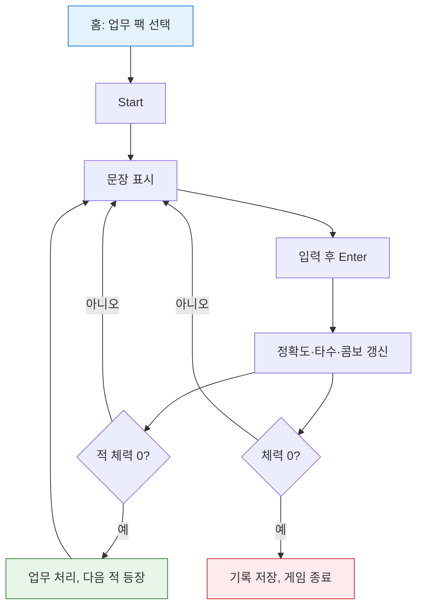

# TypingOffice (타이핑오피스)

사무실 업무를 소재로 한 한국어 타자 연습 웹 게임입니다. 문장을 정확히, 빠르게 입력해 서류 더미(적)를 처리하고, 체력이 바닥나면 게임이 끝납니다. 서버 없이 브라우저에서만 동작하며 기록은 `localStorage`에 저장됩니다.

## 기술 스택

- [Vite](https://vite.dev/) 7 (빌드 도구)
- 바닐라 JavaScript (ES Modules), 프레임워크 없음
- 픽셀 아트는 `src/pixel.js`에서 SVG로 생성
- 폰트: [neodgm](https://www.npmjs.com/package/@kfonts/neodgm) (네오둥근모)

## 시작하기

```bash
npm install
npx vite          # 개발 서버
npm run build     # dist/ 로 빌드
```

> `package.json`에는 `build` 스크립트만 있습니다. 개발 서버는 `npx vite`로 실행합니다.

## 게임 방법

홈에서 업무 팩을 고르고 **Start**를 누르면 화면에 문장이 나타납니다. 문장을 입력하고 **Enter**로 제출합니다.

| 항목 | 설명 |
|------|------|
| 체력(HP) | 100에서 시작. 적의 공격을 받으면 감소하고, 0이 되면 게임 종료 |
| 콤보 | 빠르고 정확하게 칠수록 상승. 콤보가 높을수록 적에게 주는 피해 증가 |
| 커피 게이지(MP) | 정확도에 비례해 충전. 가득 차면 빈 입력창에 `커피`를 입력해 체력 30 회복 |
| 적 | 서류 더미(8초마다 4 피해), 보스 부장님 결재(5초마다 8 피해) |

단축키: `Enter` 제출 · `ESC` 입력 지우기

타수는 한글 음절을 자모 단위 키 입력 수로 환산해 계산합니다(`src/game.js`의 `strokes`).

### 게임 흐름

홈에서 팩을 선택해 시작하면, 문장 입력과 적 처치를 반복하다가 체력이 0이 되면 기록을 저장하고 종료합니다.



## 업무 팩

| 팩 | 내용 |
|----|------|
| 업무 일지 | 하루 업무를 정리하는 짧은 문장 |
| 회의록 | 회의 관련 문장 |
| 영어 메일 | 영문 비즈니스 메일 문장 |

문장 데이터는 `src/sentences.js`의 `PACKS`에서 추가·수정합니다.

## 랭킹

게임 종료 시 기록이 저장되며, 처리한 업무 수가 많은 순, 같으면 최고 타수가 높은 순으로 상위 10명을 보여 줍니다. 로그인은 닉네임만 입력하는 방식이며 이 기기의 브라우저에만 저장됩니다(서버 없음).

## 프로젝트 구조

```
index.html          메인 페이지
Help/Help_Kor.html  도움말 페이지
src/
  main.js           라우팅(해시), 홈·랭킹 화면, 로그인
  game.js           게임 로직
  panel.js          게임 패널 마크업
  pixel.js          픽셀 스프라이트(SVG) 생성
  scene.js          사무실 배경
  sentences.js      문장 팩 데이터
  store.js          localStorage 래퍼
  *.css             스타일
public/fonts/       폰트
dist/               빌드 산출물
```

## 라우트

| 해시 | 화면 |
|------|------|
| `#/` | 홈 |
| `#/game` | 게임 |
| `#/ranking` | 랭킹 |
